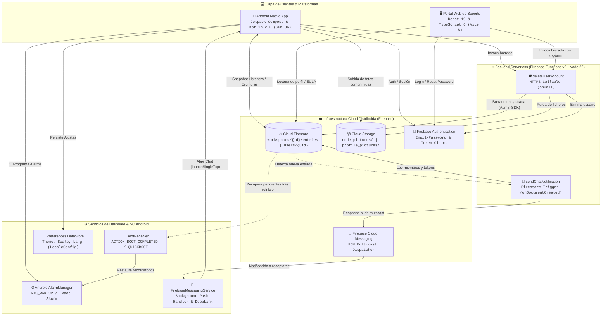
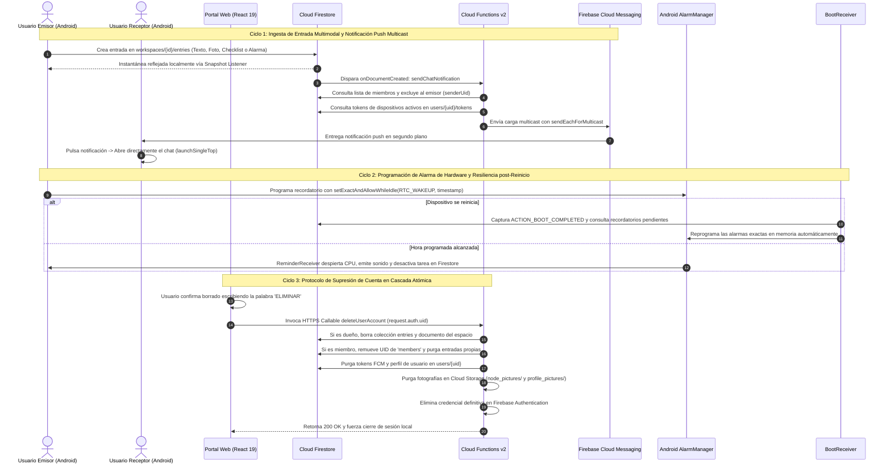

# 🌐 NODES — Real-Time Collaborative Workspace Ecosystem

> Plataforma integral de espacios de trabajo colaborativos y mensajería reactiva en tiempo real. Integra una aplicación móvil nativa en **Android** (Kotlin 2.2, Jetpack Compose, SDK 36), un portal web SPA para soporte institucional, cumplimiento de licencias y gobernanza de cuentas (React 19, TypeScript 6, Vite 8) y un motor serverless en la nube con microservicios reactivos en **Firebase Cloud Functions v2** (Node.js 22 LTS, Cloud Firestore, FCM Multicast, Cloud Storage).

[](https://kotlinlang.org/)
[--3DDC84?style=flat&logo=android&logoColor=white)](https://developer.android.com/about/versions/15)
[](https://developer.android.com/jetpack/compose)
[](https://react.dev/)
[](https://www.typescriptlang.org/)
[](https://vitejs.dev/)
[-FFCA28?style=flat&logo=firebase&logoColor=black)](https://firebase.google.com/docs/functions)
[](https://firebase.google.com/docs/firestore)
[](https://firebase.google.com/docs/cloud-messaging)
[](https://cloud.google.com/storage)
[](https://firebase.google.com/docs/hosting)

[App Móvil (Android Nativo Compose)](./nodes-android-nativo) · [Portal Web (React 19 SPA)](./nodes-front-web) · [Motor Serverless (Firebase Functions v2)](./nodes-functions) · [Portal Web Live](https://nodes-web.maxigimenez.com.ar/)

---

## Visión General & Propósito del Ecosistema

**NODES Ecosystem** resuelve la fricción en la coordinación ágil y comunicación asíncrona de equipos distribuidos mediante una arquitectura desacoplada y orientada a eventos:

1. **Espacios de Trabajo Distribuidos ("Nodos"):** Creación y unión instantánea a salas mediante códigos alfanuméricos cortos de 6 caracteres únicos generados aleatoriamente con detección automática de colisiones, jerarquía de roles estructurada (`ownerId`, `admins`, `members`) y sincronización reactiva continua a través de snapshot listeners de Cloud Firestore.
2. **Mensajería Reactiva Multimodal y Entradas Polimórficas:** Panel de chat inteligente con soporte tipado de notas de texto, listas de tareas interactivas (`CHECK_LIST`), fotos optimizadas con compresión local (`IMAGE`) y recordatorios temporizados (`REMINDER`) coordinados con el reloj de hardware de Android (`AlarmManager`).
3. **Gobernanza, Moderación y Supresión Atómica en Cascada:** Cumplimiento integral de las políticas de privacidad de Google Play Store (EULA oficial público, moderación de contenido generado por usuarios, bloqueo reactivo) y función serverless invocable `deleteUserAccount` que purga de forma transaccional todos los documentos, ficheros multimedia y credenciales de autenticación del usuario.

---

## Componentes del Ecosistema

| Módulo | Directorio | Tecnología Principal | Rol en la Solución |
| :--- | :--- | :--- | :--- |
| **Mobile Client App** | [`/nodes-android-nativo`](./nodes-android-nativo) | Kotlin 2.2.10, Android SDK 36, Jetpack Compose BOM 2024.09.00, Material 3 1.4.0, Preferences DataStore 1.0.0, Coil 2.7.0, AlarmManager, AGP 9.2.1 | Cliente móvil principal de alto rendimiento. Interfaz UDF a 60 FPS, programación de alarmas de hardware tolerantes a Doze mode, persistencia offline, captura de fotos y recepción push FCM en background. |
| **Web Support & Governance Portal** | [`/nodes-front-web`](./nodes-front-web) | React 19.2.8, TypeScript 6.0.2, Vite 8.2.2, React Router DOM 7.18.3, CSS Modules Vanilla, Firebase SDK 12.18.0, Canvas 2D | Portal web público para cumplimiento normativo (EULA oficial), autoservicio de cuenta, recuperación de contraseñas, confirmación destructiva de cuenta y deep linking directo hacia la app móvil. |
| **Serverless Cloud Engine** | [`/nodes-functions`](./nodes-functions) | Firebase Cloud Functions v2 (6.0.1), Node.js 22 LTS, Firebase Admin SDK 12.6.0, TypeScript 5.7.3, Cloud Firestore, Cloud Storage, FCM Multicast | Backend serverless reactivo. Disparador de eventos Firestore (`sendChatNotification`) para despacho push multicast a miembros de una sala y función invocable (`deleteUserAccount`) con privilegios administrativos para purga en cascada. |

---

## Flujo de Datos & Arquitectura Integral

El siguiente diagrama detalla la arquitectura de extremo a extremo, mostrando cómo los clientes móviles y web interactúan con la infraestructura distribuida de Firebase y los microservicios serverless:



---

### Ciclos Operativos del Sistema



---

## Puesta en Marcha

### Requisitos Previos
* **Java Development Kit (JDK):** Versión 17 o superior configurada en `JAVA_HOME`.
* **Android Studio:** Ladybug (2024.2.1) o superior con Android SDK Platform 36 y Android SDK Build-Tools.
* **Node.js:** Versión 22.x LTS instalada en el sistema.
* **Gestor de Paquetes:** `npm` (v10+) o `pnpm`.
* **Firebase CLI:** Instalado globalmente mediante `npm install -g firebase-tools`.
* **Dispositivo Android o Emulador:** Con Android 7.0+ (API 24+) y Google Play Services activos.

---

### Configuración de Variables de Entorno & Credenciales

#### 1. Configuración de Android (`nodes-android-nativo`)
1. Descarga el archivo oficial `google-services.json` desde Firebase Console para tu paquete `com.maxigimenez.nodes`.
2. Coloca el archivo en:
   ```text
   nodes-android-nativo/app/google-services.json
   ```
3. Verifica o genera el archivo `nodes-android-nativo/local.properties`:
   ```properties
   sdk.dir=C\:\\Users\\tu_usuario\\AppData\\Local\\Android\\Sdk
   TERMS_URL=https://nodes-web.maxigimenez.com.ar/eula
   PASSWORD_RESET_URL=https://nodes-web.maxigimenez.com.ar/passwordReset
   ```

#### 2. Configuración del Portal Web (`nodes-front-web`)
Copia la plantilla de entorno e ingresa tus credenciales públicas de Firebase:
```bash
cd nodes-front-web
cp .env.example .env
```

Variables requeridas en `nodes-front-web/.env`:
```ini
VITE_FIREBASE_API_KEY=AIzaSy...
VITE_FIREBASE_AUTH_DOMAIN=tu-proyecto.firebaseapp.com
VITE_FIREBASE_DATABASE_URL=https://tu-proyecto-default-rtdb.firebaseio.com
VITE_FIREBASE_PROJECT_ID=tu-proyecto
VITE_FIREBASE_STORAGE_BUCKET=tu-proyecto.firebasestorage.app
VITE_FIREBASE_MESSAGING_SENDER_ID=1234567890
VITE_FIREBASE_APP_ID=1:1234567890:web:abcdef123456
VITE_FIREBASE_MEASUREMENT_ID=G-XXXXXXXXXX
VITE_APP_LOGIN_DEEP_LINK=nodes://login
VITE_PLAY_STORE_URL=https://play.google.com/store/apps/details?id=com.maxigimenez.nodes
```

---

### Ejecución en Modo Desarrollo

#### Paso 1: Iniciar el Portal Web de Soporte
```bash
# 1. Navegar al directorio del frontend web
cd nodes-front-web

# 2. Instalar dependencias
npm install

# 3. Iniciar el servidor de desarrollo Vite con Hot Module Replacement
npm run dev
```
*El portal estará accesible de inmediato en [http://localhost:5173](http://localhost:5173).*

#### Paso 2: Ejecutar los Microservicios Serverless
```bash
# 1. En una nueva terminal, navegar al directorio de funciones
cd nodes-functions

# 2. Instalar dependencias
npm install

# 3. Compilar TypeScript e iniciar emulador local de funciones
npm run build
npm run serve
```
*Los emuladores expondrán localmente las funciones `sendChatNotification` y `deleteUserAccount`.*

#### Paso 3: Compilar y Desplegar la Aplicación Android
Abre la carpeta [`nodes-android-nativo`](./nodes-android-nativo) en Android Studio y ejecuta una sincronización de Gradle, o despliega directamente vía CLI con tu emulador o teléfono conectado:
```bash
cd nodes-android-nativo
./gradlew installDebug
```

---

### Verificación de Código, Linter y Pruebas

```bash
# 1. Linter y verificación de tipos en Frontend Web
cd nodes-front-web
npm run lint
npm run build

# 2. Linter y compilación en Cloud Functions
cd ../nodes-functions
npm run lint
npm run build

# 3. Pruebas unitarias de JVM en Android Nativo
cd ../nodes-android-nativo
./gradlew testDebugUnitTest
```

---

### Compilación para Producción & Distribución

```bash
# 1. Generar bundle optimizado para Web
cd nodes-front-web
npm run build
npm run preview

# 2. Generar APK y Android App Bundle (AAB) para Google Play Store con R8/ProGuard activado
cd ../nodes-android-nativo
./gradlew assembleRelease
./gradlew bundleRelease
```

---

### Despliegue en la Nube (Cloud Deployment)

```bash
# Despliegue de funciones serverless en Google Cloud
cd nodes-functions
firebase deploy --only functions

# Despliegue del portal web en Firebase Hosting
cd ../nodes-front-web
npm run build
firebase deploy --only hosting
```

---

## Topología de Servicios y Puertos Locales

| Servicio | Entorno | URL / Puerto Local | Credenciales / Configuración |
| :--- | :--- | :--- | :--- |
| **Portal Web (Soporte)** | React 19 (Vite) | `http://localhost:5173` | Configurado vía `.env` |
| **Portal Web (Producción)** | Firebase Hosting Edge | `https://nodes-web.maxigimenez.com.ar` | Certificado SSL administrado |
| **Cloud Functions (Emulador)** | Node.js 22 (CLI) | `http://localhost:5001` / `localhost:8080` | Emulador local Firebase Suite |
| **App Móvil (Android)** | Android Runtime | Emulador / Dispositivo físico (API 24+) | Paquete `com.maxigimenez.nodes` |
| **Base de Datos NoSQL** | Cloud Firestore | Cloud RealTime (Google Cloud us-central1) | Colecciones `workspaces`, `users` |
| **Almacenamiento Binario** | Cloud Storage | Cloud Bucket | `node_pictures/`, `profile_pictures/` |
| **Servicio de Identidad** | Firebase Authentication | Identity Platform | Correo / Contraseña |

---

## Comparativa del Stack Tecnológico

| Capa del Sistema | App Móvil (`nodes-android-nativo`) | Portal Web (`nodes-front-web`) | Motor Serverless (`nodes-functions`) |
| :--- | :--- | :--- | :--- |
| **Lenguaje & Core** | Kotlin `2.2.10`, Corrutinas `1.11.0` | TypeScript `~6.0.2`, React `^19.2.8` | TypeScript `^5.7.3`, Node.js `22` LTS |
| **Framework / Runtime** | Android SDK 36 (UpsideDownCake+), Jetpack Compose BOM 2024.09 | Vite `^8.2.2`, React Router DOM `^7.18.3` | Google Cloud Functions v2 (`firebase-functions ^6.0.1`) |
| **Gestión de Estado** | Flujo Unidireccional (UDF), `StateFlow`, `collectAsStateWithLifecycle` | Context API (`AuthContext`), React State, Hooks | Stateless Event-Driven & HTTPS Callables |
| **Red & Integración** | Firebase Android BoM `34.3.0`, Firestore SDK, Storage SDK | Firebase Web SDK `^12.18.0`, `httpsCallable` | Firebase Admin SDK `^12.6.0`, FCM Multicast |
| **Persistencia Local** | Preferences DataStore `1.0.0` (`SettingsManager`) | `sessionStorage` / Cookies de sesión Firebase | Stateless (Persistencia en Firestore y Storage) |
| **Seguridad & Auth** | Firebase Auth SDK, Reglas Firestore, BCrypt Auth | Firebase Web Auth, Rutas protegidas (`ProtectedRoute`) | Token Verification `request.auth`, Admin Privileges |
| **Diseño & UI** | Material 3 `1.4.0`, Dynamic Color, Canvas Compose (`withFrameNanos`) | Vanilla CSS Modules (`*.module.css`), Canvas 2D (`requestAnimationFrame`) | N/A (JSON Responses / Cloud Events) |
| **Hardware & SO** | AlarmManager (`RTC_WAKEUP`), `BootReceiver`, `LocaleConfig` | Web Storage APIs, Navigator APIs, Deep Link Handlers | Google Cloud Runtime Environment (Cloud Run) |
| **Calidad & Tooling** | AGP `9.2.1`, R8/ProGuard Optimizer, JUnit `4.13.2` | ESLint `^10.9.0`, TypeScript-ESLint `^8.67.0` | ESLint `^8.9.0`, Google ESLint Config |
| **Despliegue & DevOps** | Android App Bundle (AAB) / Google Play Console | Firebase Hosting (Global Edge CDN con rewrites SPA) | Firebase CLI Multi-Region Cloud Functions |

---

## Decisiones de Ingeniería & Trade-offs Clave

### 1. Renderizado a 60 FPS en Canvas (Bypass de Reconciliación)
* **Desafío:** Renderizar decenas de partículas en movimiento continuo calculando distancias de atracción euclidianas en tiempo real sin degradar la capacidad de respuesta ni sobrecalentar el dispositivo.
* **Decisión:** En el portal web, se prescindió del Virtual DOM de React delegando el redibujado en un elemento `<canvas>` gobernado por `requestAnimationFrame`. En Android Jetpack Compose, se implementó un `Canvas` desacoplado que sincroniza los frames mediante `withFrameNanos` en `Components.kt`.
* **Trade-off:** Requiere lógica de trazado vectorial y manejo manual de vectores, pero reduce a cero la sobrecarga de instanciación de objetos en el hilo de interfaz.

---

### 2. Arquitectura de Estado Unidireccional (UDF) & Lifecycle-Aware Flows
* **Desafío:** Evitar que los snapshot listeners de Firestore en segundo plano consuman datos y batería cuando la pantalla no está visible, previniendo fugas de memoria y bloqueos en rotaciones de dispositivo.
* **Decisión:** Los ViewModels exponen datos a través de `StateFlow` y la UI consume el estado mediante `collectAsStateWithLifecycle()`. Al pausarse la actividad o pantalla, el flujo detiene de forma transparente la recolección de eventos.
* **Trade-off:** Requiere incluir `lifecycle-runtime-compose`, pero garantiza un consumo óptimo de recursos en dispositivos móviles.

---

### 3. Supresión Atómica en Cascada en Cloud Functions v2 vs SDK Cliente
* **Desafío:** Al eliminar una cuenta (cumplimiento GDPR y EULA), se deben borrar registros en múltiples colecciones, subcolecciones de mensajes, ficheros en Cloud Storage y la cuenta de Firebase Authentication.
* **Decisión:** Toda la lógica destructiva se encapsuló en la Cloud Function invocable `deleteUserAccount` ejecutada con credenciales administrativas (`firebase-admin`).
* **Trade-off:** Introduce una dependencia de Cloud Functions, pero garantiza integridad transaccional, evita la limitación de 500 operaciones por lote del SDK cliente y previene cuentas huérfanas ante caídas de red.

---

### 4. Tolerancia a Fallos y Doze Mode con AlarmManager & BootReceiver
* **Desafío:** A partir de Android 12 (API 31), el sistema operativo restringe severamente las alarmas exactas para mitigar el consumo de batería, cancelando además todas las alarmas programadas en memoria cuando el teléfono se reinicia físicamente.
* **Decisión:** Se implementó verificación preventiva con `AlarmScheduler.canScheduleExactAlarms`, invocando `AlarmManager.setExactAndAllowWhileIdle(RTC_WAKEUP, ...)` para despertar el CPU incluso en Doze mode. Para tolerar reinicios, `BootReceiver` intercepta `ACTION_BOOT_COMPLETED` y `QUICKBOOT_POWERON`, consultando Firestore y reprogramando las alarmas automáticamente en segundo plano.
* **Trade-off:** Requiere el permiso `RECEIVE_BOOT_COMPLETED` y lecturas iniciales tras el arranque, pero asegura confiabilidad absoluta en las alertas del usuario.

---

### 5. Navegación Atómica y Limpieza de Deep Links tras Notificación Push
* **Desafío:** Cuando el usuario pulsa sobre una notificación push de FCM mientras navega por la aplicación, la navegación al chat específico no debe duplicar la pantalla en el backstack ni provocar bucles infinitos de recomposición.
* **Decisión:** El `pendingWorkspaceId` se almacena como un `StateFlow` en `AuthViewModel` y es consumido con `launchSingleTop = true` e inmediatamente limpiado mediante `clearPendingWorkspaceId()` dentro de un `LaunchedEffect` en `ContentNavigation.kt`.
* **Trade-off:** Requiere orquestar el paso de parámetros entre `NodesApplication` y `AuthViewModel`, pero garantiza transiciones atómicas e inmunes a recomposiciones espurias.

---

## Autor & Contacto

* **Maximiliano Giménez**
* **Portfolio:** [maxigimenez.com.ar](https://maxigimenez.com.ar)
* **GitHub:** [@MaximilianoGimenez0](https://github.com/MaximilianoGimenez0)
* **LinkedIn:** [Maximiliano Giménez](https://www.linkedin.com/in/)