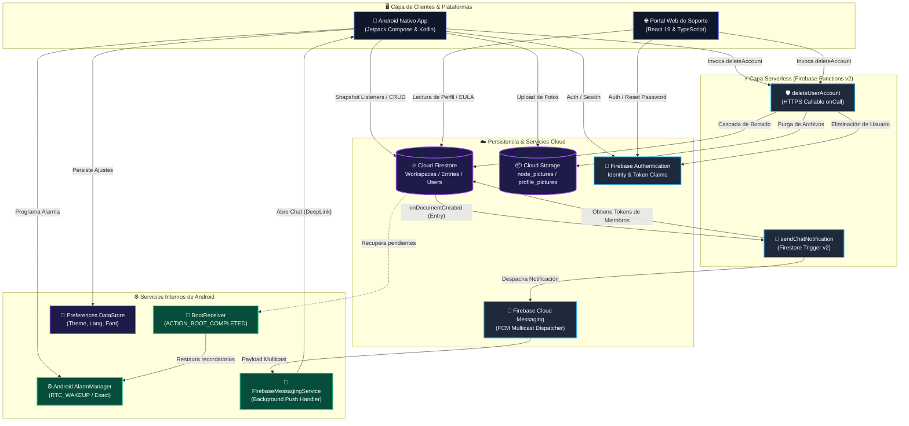

# 🌐 NODES — Real-Time Collaborative Workspace Ecosystem

> Plataforma integral de espacios de trabajo colaborativos y mensajería reactiva en tiempo real, diseñada con arquitectura full-stack moderna que sincroniza de forma nativa dispositivos móviles Android, portales web de soporte/gestión y microservicios serverless en la nube bajo estándares estrictos de rendimiento a 60 FPS, resiliencia offline y privacidad de datos.


-3DDC84.svg?style=for-the-badge&logo=android&logoColor=white)


-FFCA28.svg?style=for-the-badge&logo=firebase&logoColor=black)


---

## 🧩 Stack Tecnológico & Ecosistema

El ecosistema **NODES** fue concebido bajo premisas de ingeniería de desacoplamiento modular, reactividad basada en flujos unidireccionales (UDF), tipado estricto extremo a extremo y procesamiento asíncrono no bloqueante entre plataformas heterogéneas.

### Android Nativo & Mobile Core
* **Kotlin 2.2 (`2.2.10`):** Lenguaje principal de desarrollo móvil, utilizando el compilador Kotlin Compose 2.0 integrado, corrutinas de alto rendimiento y flujos asíncronos fríos y calientes (`Flow`, `StateFlow`).
* **Android SDK 36 (`compileSdk 36`, `targetSdk 36`, `minSdk 24`):** Compatibilidad garantizada desde Android 7.0 Nougat hasta Android 15/16, soportando `LocaleConfig` declarativo y políticas de permisos de alarmas exactas de Android 12+.
* **Jetpack Compose (`BOM 2024.09.00`):** Toolkit declarativo moderno para la interfaz gráfica móvil, eliminando la sobrecarga de inflado de vistas XML y sincronizando animaciones a través de `withFrameNanos`.
* **Material 3 (`1.4.0`):** Sistema de diseño adaptable con soporte nativo para Dynamic Color (Material You), esquemas tonalmente balanceados y tipografía responsiva.
* **Navigation Compose (`2.9.5`):** Enrutador centralizado con grafos anidados (`workspaces_graph`), transiciones cinéticas horizontales con curvas Bézier (`FastOutSlowInEasing`) y manejo seguro de backstack.
* **Preferences DataStore (`1.0.0`):** Motor de almacenamiento local transaccional y asíncrono que reemplaza de forma segura a `SharedPreferences` para persistir configuración de usuario (`AppSettings`).
* **Android AlarmManager (`RTC_WAKEUP` & `setExactAndAllowWhileIdle`):** Programador nativo de alarmas temporizadas de hardware capaces de disparar notificaciones en modo Doze.
* **Coil Compose (`2.7.0`):** Biblioteca asíncrona de carga de imágenes respaldada por corrutinas de Kotlin, decodificación en segundo plano y caché en memoria/disco.

### Web Frontend & Portal de Gestión
* **React 19 (`19.2.8`):** Biblioteca de interfaz reactiva, implementando hooks modernos, transiciones concurrentes y sincronización de sesión en tiempo real.
* **TypeScript 6 (`~6.0.2`):** Superset tipado estricto con validaciones en tiempo de compilación y cero supresiones inseguras de tipos.
* **Vite 8 (`8.2.2`):** Entorno de empaquetado y servidor de desarrollo ultra veloz con Hot Module Replacement (HMR) casi instantáneo y optimización de assets con Rollup.
* **React Router DOM 7 (`7.18.3`):** Enrutador de aplicación web con guardias de seguridad para rutas autenticadas (`ProtectedRoute`) y redirecciones declarativas.
* **HTML5 Canvas 2D Engine:** Motor de renderizado vectorial por software integrado en React que simula la red topológica de partículas interconectadas a 60 FPS.
* **CSS Modules (Vanilla CSS):** Encapsulación de estilos por componente sin sobrecarga de runtime ni dependencias de utilidades externas.

### Backend Serverless & Cloud Infrastructure
* **Firebase Cloud Functions v2 (`firebase-functions ^6.0.1`):** Entorno de ejecución serverless de segunda generación sobre Google Cloud Functions con soporte de eventos Firestore (`onDocumentCreated`) y llamadas HTTPS invocables (`onCall`).
* **Node.js 22 LTS (`engine 22`):** Runtime de alto rendimiento para microservicios backend con soporte ESM nativo y APIs web estándar.
* **Firebase Admin SDK (`12.6.0`):** Interfaz administrativa con privilegios elevados para orquestar Firestore, Firebase Authentication, Cloud Storage y FCM.
* **Cloud Firestore:** Base de datos NoSQL distribuida orientada a documentos, que actúa como bus de sincronización reactivo en tiempo real entre Android y la Web.
* **Cloud Storage for Firebase:** Almacenamiento distribuido de objetos para imágenes de perfil de usuarios y contenido multimedia de los espacios de trabajo.
* **Firebase Cloud Messaging (FCM):** Canal de mensajería push distribuida con entrega multicast dirigida a dispositivos cliente mediante tokens registrados.

### Tooling, Compilación & Calidad de Código
* **Android Gradle Plugin (`9.2.1`):** Sistema de construcción modular para Android con gestión unificada de versiones mediante Version Catalogs (`libs.versions.toml`).
* **R8 / ProGuard Optimizer:** Minificación de bytecode, ofuscación de código y `shrinkResources` activado para empaquetados APK/AAB de producción optimizados.
* **ESLint 10 (`10.9.0`) & TypeScript ESLint (`8.67.0`):** Reglas de linter estandarizadas para el cliente web y backend serverless.

---

## 📦 Instalación y Puesta en Marcha

El repositorio está estructurado como un monorepo que alberga la aplicación nativa Android ([`nodes-android-nativo`](file:///d:/Projects/nodes/nodes-android-nativo)), el portal web de autoservicio ([`nodes-front-web`](file:///d:/Projects/nodes/nodes-front-web)) y los microservicios serverless ([`nodes-functions`](file:///d:/Projects/nodes/nodes-functions)).

### Requisitos Previos
* **Java Development Kit (JDK):** Versión 17 o superior (configurado en `JAVA_HOME`).
* **Android Studio:** Ladybug (2024.2.1) o superior con Android SDK Platform 36 y Android SDK Build-Tools.
* **Node.js:** Versión 22.x LTS instalada en el sistema.
* **Gestor de Paquetes:** `npm` (v10+) o `pnpm`.
* **Firebase CLI:** Instalado globalmente mediante `npm install -g firebase-tools`.
* **Dispositivo Android o Emulador:** Con Android 7.0+ (API 24+) y Google Play Services activos.

---

### 1. Clonar el Repositorio
```bash
git clone https://github.com/MaximilianoGimenez0/nodes.git
cd nodes
```

---

### 2. Aprovisionamiento e Instalación de Dependencias

Ejecuta la instalación de paquetes tanto para el portal web como para las Cloud Functions:

```bash
# Instalación de dependencias del Portal Web
cd nodes-front-web
npm install

# Instalación de dependencias de Backend Serverless
cd ../nodes-functions
npm install

# Retornar a la raíz del proyecto
cd ..
```

---

### 3. Configuración de Variables de Entorno y Firebase

> [!IMPORTANT]
> Para el correcto funcionamiento de la autenticación, notificaciones push y almacenamiento de medios, debes aprovisionar los archivos de credenciales oficiales de tu proyecto de Firebase.

#### A. Configuración de Firebase en Android (`nodes-android-nativo`)
1. Descarga el archivo `google-services.json` desde la consola de Firebase para tu paquete `com.maxigimenez.nodes`.
2. Coloca el archivo en la ruta:
   [`nodes-android-nativo/app/google-services.json`](file:///d:/Projects/nodes/nodes-android-nativo/app/google-services.json)
3. Crea un archivo `local.properties` en la carpeta `nodes-android-nativo/` para personalizar URLs de términos o restablecimiento de clave:
   ```properties
   TERMS_URL=https://nodes-web.maxigimenez.com.ar/eula
   PASSWORD_RESET_URL=https://nodes-web.maxigimenez.com.ar/login
   ```

#### B. Configuración de Variables de Entorno en Web (`nodes-front-web`)
Crea tu archivo `.env` basándote en la plantilla `.env.example`:

```bash
cd nodes-front-web
cp .env.example .env
```

Edita `.env` con las claves públicas de tu aplicación web de Firebase:
```ini
VITE_FIREBASE_API_KEY=AIzaSy...
VITE_FIREBASE_AUTH_DOMAIN=tu-proyecto.firebaseapp.com
VITE_FIREBASE_DATABASE_URL=https://tu-proyecto-default-rtdb.firebaseio.com
VITE_FIREBASE_PROJECT_ID=tu-proyecto
VITE_FIREBASE_STORAGE_BUCKET=tu-proyecto.firebasestorage.app
VITE_FIREBASE_MESSAGING_SENDER_ID=1234567890
VITE_FIREBASE_APP_ID=1:1234567890:web:abcdef123456
VITE_FIREBASE_MEASUREMENT_ID=G-XXXXXXXXXX

# Deep links de integración hacia la app móvil
VITE_APP_LOGIN_DEEP_LINK=nodes://login
VITE_PLAY_STORE_URL=https://play.google.com/store/apps/details?id=com.maxigimenez.nodes
```

---

### 4. Ejecución en Modo Desarrollo

#### A. Levantar el Portal Web de Soporte (Vite Dev Server)
```bash
cd nodes-front-web
npm run dev
```
Accede a la interfaz en tu navegador en: `http://localhost:5173`.

#### B. Levantar Emuladores Locales de Firebase Functions
```bash
cd nodes-functions
npm run build
npm run serve
```
El emulador expondrá localmente la función `sendChatNotification` y la invocable `deleteUserAccount`.

#### C. Compilar y Ejecutar la Aplicación Android
Abre la carpeta [`nodes-android-nativo`](file:///d:/Projects/nodes/nodes-android-nativo) en Android Studio y ejecuta una sincronización de Gradle, o despliega directamente vía CLI:

```bash
cd nodes-android-nativo
./gradlew installDebug
```

---

### 5. Verificación de Código, Linter y Tipado Estático

```bash
# Verificación de linter y tipos en Frontend Web
cd nodes-front-web
npm run lint
npx tsc --noEmit

# Verificación de linter y compilación en Functions
cd ../nodes-functions
npm run lint
npm run build

# Pruebas unitarias en Android
cd ../nodes-android-nativo
./gradlew testDebugUnitTest
```

---

### 6. Compilación para Producción y Preview

```bash
# Compilar bundle optimizado para Web
cd nodes-front-web
npm run build
npm run preview

# Compilar APK y Android App Bundle (AAB) para Google Play Store
cd ../nodes-android-nativo
./gradlew assembleRelease
./gradlew bundleRelease
```

---

### 7. Despliegue en la Nube (Cloud Deployment)

> [!TIP]
> Puedes desplegar las Cloud Functions y el hosting web en tu proyecto de Firebase con un único comando:

```bash
# Despliegue de funciones serverless
cd nodes-functions
firebase deploy --only functions

# Despliegue del portal web en Firebase Hosting
cd ../nodes-front-web
npm run build
firebase deploy --only hosting
```

---

## 💎 Capacidades & Características Clave

* **📡 Workspaces y Nodos Colaborativos en Tiempo Real:** Creación y unión instantánea a nodos colaborativos mediante códigos alfanuméricos cortos de 6 caracteres únicos generados aleatoriamente con detección automática de colisiones.
  * Jerarquía de roles estructurada: Dueño (`ownerId`), administradores (`admins`) y miembros regulares (`members`).
  * Sincronización continua de estado con snapshot listeners de Firestore para metadatos, imagen del espacio y membresías.
* **💬 Mensajería Reactiva Multimodal y Entradas Polimórficas:** Panel de chat inteligente con soporte de entradas categorizadas:
  * Mensajes de texto instantáneos con avatar del autor y timestamp de servidor.
  * Listas de verificación compartidas (`CHECK_LIST`) con actualización reactiva de items individuales en tiempo real.
  * Registro y despliegue de imágenes optimizadas (`IMAGE`) con visor fullscreen inmersivo y zoom gestual.
  * Filtrado granular instantáneo de entradas por categoría en la interfaz mediante chips interactivos (`CategoryFilterRow`).
* **⏰ Motor de Recordatorios Locales y Alarmas Exactas:** Programación temporal precisa mediante `AlarmManager.setExactAndAllowWhileIdle()` en el dispositivo Android (`RTC_WAKEUP`):
  * Compatibilidad estricta con el permiso `SCHEDULE_EXACT_ALARM` en Android 12+ (API 31+).
  * Tolerancia al Doze Mode de ahorro de batería de Android.
  * Persistencia resiliente tras reinicio físico del teléfono (`ACTION_BOOT_COMPLETED` y `QUICKBOOT_POWERON`) a través de [`BootReceiver`](file:///d:/Projects/nodes/nodes-android-nativo/app/src/main/java/com/maxigimenez/nodes/features/nodes/entries/BootReceiver.kt) que restaura alarmas pendientes desde Firestore.
* **🔔 Notificaciones Push Multicast (FCM):** Microservicio en Cloud Functions v2 que escucha la creación de documentos en `workspaces/{workspaceId}/entries/{entryId}`:
  * Resuelve la lista de miembros destinatarios excluyendo activamente al emisor del mensaje.
  * Consulta la colección de tokens FCM de los dispositivos receptores (`users/{uid}/tokens`).
  * Despacha notificaciones multicast agrupadas por canal de alta prioridad.
  * Redirección instantánea (Deep Link) hacia la sala de chat correspondiente mediante `pendingWorkspaceId` consumido en la navegación de Compose.
* **🎨 Lienzo Gráfico Interactivo de Nodos (Canvas 2D & Compose Canvas):** Motor gráfico cinemático implementado tanto en Jetpack Compose ([`Components.kt`](file:///d:/Projects/nodes/nodes-android-nativo/app/src/main/java/com/maxigimenez/nodes/core/ui/components/Components.kt)) como en React ([`NodesBackground.tsx`](file:///d:/Projects/nodes/nodes-front-web/src/components/NodesBackground.tsx)):
  * Simulación física de partículas en movimiento continuo con rebote elástico en los límites de la ventana.
  * Cálculo dinámico de distancias euclidianas entre nodos y renderizado de aristas con degradado de opacidad alfa en tiempo real a 60 FPS.
* **🔐 Autenticación Híbrida y Gestión de Sesión:** Integración con Firebase Authentication para registro por correo/contraseña, verificación de credenciales, y recuperación de contraseña vía correo electrónico con validación tipográfica de errores (`AUTH_ERRORS`).
* **🛡️ Seguridad, Moderación y Supresión Atómica de Cuenta (GDPR/EULA):**
  * Bloqueo local y remoto de usuarios indeseados (`blockedUsers`), ocultando instantáneamente sus mensajes y actividades en el chat.
  * Sistema de reporte de contenido abusivo (`reports`) persistido en Firestore para auditoría.
  * Eliminación de cuenta en cascada atómica vía Cloud Function invocable `deleteUserAccount`: si el usuario es dueño de un nodo, borra todas las subcolecciones, metadatos y ficheros en Cloud Storage; si es miembro, lo retira y limpia sus entradas; finalmente elimina sus tokens, perfil y credencial de Firebase Auth.
* **🌐 Internacionalización y Personalización Accesible:**
  * Soporte multi-idioma (Español, Inglés, Portugués) mediante `LocaleConfig` de Android 13+.
  * Soporte de temas adaptativos: Claro, Oscuro y Automático según el sistema operativo.
  * Selector dinámico de escala de fuente de la aplicación persistido de forma no volátil en Preferences DataStore.

---

## 🌊 Flujo de Datos & Dinámica del Sistema

El desafío técnico neurálgico de **NODES** radica en la coordinación asíncrona de estados entre clientes móviles nativos y portales web conectados a una base de datos documental distribuida NoSQL, garantizando una latencia percibida cercana a cero, evitando fugas de memoria por listeners huérfanos y asegurando que las operaciones destructivas respeten la integridad referencial.

### Pipeline de Datos & Sincronización en Tiempo Real

```
[Usuario / Dispositivo Móvil]
           │
           ▼ (Interacción UI / Captura de Evento)
[Jetpack Compose Screen] ────> [NodesViewModel (StateFlow)]
                                      │
                                      ▼ (Corrutina con Dispatchers.IO)
                           [Cloud Firestore SDK]
                                      │
           ┌──────────────────────────┴──────────────────────────┐
           ▼ (Escritura en Documento)                             ▼ (Snapshot Listener)
[workspaces/{id}/entries]                                [NodesViewModel StateFlow]
           │                                                     │
           ▼ (Evento onDocumentCreated v2)                        ▼ (Recomposición Compose)
[Cloud Function: sendChatNotification]                   [LazyColumn Chat / Checklists]
           │
           ├─► Resuelve tokens de miembros receptores
           │
           ▼ (FCM Multicast Payload)
[Google Firebase Cloud Messaging] ────(Push)────> [FirebaseMessagingService]
                                                           │
                                                           ▼ (Si la App está en Background)
                                                [NotificationManager & DeepLink]
```

---

### 1. Ingesta, Filtrado y Sincronización Reactiva de Mensajes
1. El usuario envía un mensaje, imagen o tarea desde [`NodeChatScreen.kt`](file:///d:/Projects/nodes/nodes-android-nativo/app/src/main/java/com/maxigimenez/nodes/features/nodes/entries/NodeChatScreen.kt).
2. El [`NodesViewModel.kt`](file:///d:/Projects/nodes/nodes-android-nativo/app/src/main/java/com/maxigimenez/nodes/features/nodes/list/NodesViewModel.kt) procesa los datos; en caso de imágenes, comprime el mapa de bits localmente mediante [`ImageUtils.compressImage`](file:///d:/Projects/nodes/nodes-android-nativo/app/src/main/java/com/maxigimenez/nodes/core/util/ImageUtils.kt), sube los bytes a Cloud Storage (`nodes/{nodeId}/entries/{UUID}.jpg`) y almacena la URL resultante en Firestore.
3. El listener de instantáneas (`addSnapshotListener`) en `workspaces/{nodeId}/entries` emite la nueva lista ordenada por `createdAt`.
4. El flujo filtra activamente los mensajes emitidos por usuarios presentes en la lista `blockedUsers` del perfil del cliente actual antes de proyectar la lista en la UI.

---

### 2. Motor de Física y Topología de Red en Lienzo Gráfico (Canvas)
Tanto la aplicación móvil ([`Components.kt`](file:///d:/Projects/nodes/nodes-android-nativo/app/src/main/java/com/maxigimenez/nodes/core/ui/components/Components.kt)) como el portal web ([`NodesBackground.tsx`](file:///d:/Projects/nodes/nodes-front-web/src/components/NodesBackground.tsx)) ejecutan un bucle de animación a 60 FPS donde cada partícula $p_i$ posee posición $(x_i, y_i)$, velocidad $(\Delta x_i, \Delta y_i)$ y radio $r_i$:

$$x_i \leftarrow x_i + \Delta x_i \cdot s, \quad y_i \leftarrow y_i + \Delta y_i \cdot s$$

Donde $s$ es el multiplicador de velocidad. Si la partícula colisiona con el contorno de la pantalla ($x_i \le 0$ o $x_i \ge W$), el vector velocidad horizontal se invierte: $\Delta x_i \leftarrow -\Delta x_i$.

Para cada par de nodos $(p_i, p_j)$ con $i < j$, se computa la distancia euclidiana:

$$d(p_i, p_j) = \sqrt{(x_i - x_j)^2 + (y_i - y_j)^2}$$

Si $d(p_i, p_j) < d_{\text{max}}$, se proyecta una arista de conexión cuya opacidad $\alpha$ se atenúa gradualmente en función de la proximidad:

$$\alpha = \left(1 - \frac{d(p_i, p_j)}{d_{\text{max}}}\right) \cdot \alpha_{\text{base}}$$

Este algoritmo genera el efecto visual representativo de una red viva e interconectada sin comprometer el hilo de la interfaz de usuario.

---

### 3. Ciclo de Vida de Alarmas y Resiliencia ante Reinicio
1. Cuando se genera una entrada de tipo `REMINDER`, [`AlarmScheduler.schedule`](file:///d:/Projects/nodes/nodes-android-nativo/app/src/main/java/com/maxigimenez/nodes/features/nodes/entries/NodeReminders.kt) valida el permiso `canScheduleExactAlarms` en Android 12+.
2. Se programa un `PendingIntent` inmutable con identificador único derivado del hash del ID de la entrada (`entryId.hashCode()`) mediante `AlarmManager.setExactAndAllowWhileIdle(RTC_WAKEUP, timestamp, pendingIntent)`.
3. Al dispararse, [`ReminderReceiver`](file:///d:/Projects/nodes/nodes-android-nativo/app/src/main/java/com/maxigimenez/nodes/features/nodes/entries/NodeReminders.kt) construye una notificación de alta prioridad y actualiza el estado de la tarea en Firestore a inactiva (`isChecked = false`).
4. Si el dispositivo se apaga o reinicia, [`BootReceiver.kt`](file:///d:/Projects/nodes/nodes-android-nativo/app/src/main/java/com/maxigimenez/nodes/features/nodes/entries/BootReceiver.kt) intercepta `Intent.ACTION_BOOT_COMPLETED`, consulta a Firestore todas las entradas `REMINDER` de los espacios a los que pertenece el usuario y las reprograma de forma transparente en segundo plano.

---

### 4. Protocolo de Supresión de Cuenta en Cascada Atómica
La función invocable [`deleteUserAccount`](file:///d:/Projects/nodes/nodes-functions/src/index.ts) asegura el cumplimiento de regulaciones de privacidad y normas de convivencia (EULA):

```
[Solicitud de Borrado: Web o Android]
                 │
                 ▼ (Callable Function: deleteUserAccount)
     [Verificación Auth en Contexto (request.auth.uid)]
                 │
    ┌────────────┴────────────┐
    ▼                         ▼
[Es Owner de Workspace]    [Es Miembro de Workspace]
    │                         │
    ├─► Borra entries         ├─► Remueve UID de 'members'
    ├─► Borra doc workspace   └─► Borra entradas propias en el workspace
    └─► Purga node_pictures/
                 │
                 ▼
[Elimina tokens FCM en users/{uid}/tokens]
                 │
                 ▼
[Elimina documento en users/{uid}]
                 │
                 ▼
[Purga profile_pictures/{uid}/ en Storage]
                 │
                 ▼
[Elimina usuario en Firebase Authentication]
                 │
                 ▼
[Respuesta OK -> Desconexión Local y Redirección]
```

---

## 📐 Arquitectura del Sistema (Mermaid)



---

## 🗂️ Anatomía del Proyecto & Directorios

```text
nodes/
├── .gitignore                                     # Reglas globales de exclusión para Git
├── README.md                                      # Documentación técnica maestra del ecosistema
│
├── nodes-android-nativo/                          # 📱 Proyecto Nativo Android (Kotlin & Compose)
│   ├── build.gradle.kts                           # Configuración Gradle raíz del proyecto móvil
│   ├── settings.gradle.kts                        # Inclusión de módulos y repositorios Gradle
│   ├── gradle/
│   │   └── libs.versions.toml                     # Catálogo centralizado de versiones y dependencias
│   └── app/
│       ├── build.gradle.kts                       # Configuración Android, SDK 36, minSdk 24, R8 y plugins
│       ├── proguard-rules.pro                     # Reglas de ofuscación y conservación para release
│       └── src/
│           └── main/
│               ├── AndroidManifest.xml            # Declaración de componentes, receptores y permisos
│               └── java/com/maxigimenez/nodes/
│                   ├── app/
│                   │   ├── MainActivity.kt        # Activity única de la aplicación con inyección de tema
│                   │   └── NodesApplication.kt    # Clase Application que rastrea el ciclo de vida de foreground
│                   ├── core/
│                   │   ├── navigation/
│                   │   │   ├── AppNavigation.kt   # Enrutador raíz con control de autenticación
│                   │   │   ├── ContentNavigation.kt # Grafo interno con Scaffold y barra inferior
│                   │   │   └── Routes.kt          # Definición fuertemente tipada de rutas y destinos
│                   │   ├── ui/
│                   │   │   ├── components/
│                   │   │   │   └── Components.kt  # Componentes reutilizables, Shimmer y NodesBackground Canvas
│                   │   │   └── theme/
│                   │   │       ├── Animations.kt  # Especificaciones Bézier, enter transitions y click effects
│                   │   │       ├── Color.kt       # Paleta cromática Material 3 (Violet/Blue/Sky)
│                   │   │       ├── Theme.kt       # Dynamic color controller y esquemas claro/oscuro
│                   │   │       └── Type.kt        # Definición de tipografía y jerarquías de texto
│                   │   └── util/
│                   │       ├── AuthValidator.kt   # Validaciones de formato de email y contraseñas
│                   │       ├── ImageUtils.kt      # Compresión y codificación de mapas de bits
│                   │       ├── LocaleHelper.kt    # Manejo dinámico de localización e idiomas
│                   │       ├── NotificationHelper.kt # Canales de notificación del sistema
│                   │       └── ToastHelper.kt     # Utilidades de retroalimentación contextual
│                   ├── data/
│                   │   ├── local/
│                   │   │   └── SettingsManager.kt # Gestor de configuración persistida con DataStore
│                   │   ├── model/
│                   │   │   └── Models.kt          # Modelos de datos Firestore (@Keep, Node, Entry, User)
│                   │   └── repository/
│                   │       ├── NodeRepository.kt  # Abstracción de acceso a datos para espacios
│                   │       └── UserRepository.kt  # Abstracción de acceso a datos para usuarios
│                   ├── features/
│                   │   ├── auth/                  # Pantallas y ViewModels de Login, Registro y Estado
│                   │   ├── home/                  # Dashboard principal y bienvenida
│                   │   ├── nodes/
│                   │   │   ├── components/        # Burbujas de chat, diálogos modales y controles
│                   │   │   ├── detail/            # Pantallas de detalle y configuración del nodo
│                   │   │   ├── entries/           # Chat reactivo, AlarmScheduler y BootReceiver
│                   │   │   └── list/              # Listado de espacios, creación y unión
│                   │   └── settings/              # Página de ajustes, selector de tema e idioma
│                   └── services/
│                       └── FirebaseMessagingService.kt # Receptor en background de notificaciones push FCM
│
├── nodes-front-web/                               # 🌐 Portal Web de Autoservicio y Soporte (React & Vite)
│   ├── package.json                               # Dependencias (React 19, Vite 8, Firebase 12, TS 6)
│   ├── vite.config.ts                             # Configuración del bundler Vite y plugin React
│   ├── firebase.json                              # Configuración de hosting y reescritura SPA
│   ├── .env.example                               # Plantilla de variables de entorno públicas
│   └── src/
│       ├── main.tsx                               # Punto de entrada de renderizado en el DOM
│       ├── App.tsx                                # Router principal y proveedor AuthProvider
│       ├── index.css                              # Reset global y variables CSS del sistema de diseño
│       ├── components/
│       │   ├── ConfirmModal.tsx                   # Modal de confirmación destructiva con keyword
│       │   ├── ForgotPasswordModal.tsx            # Modal para recuperación de clave vía Firebase Auth
│       │   ├── Navbar.tsx                         # Barra superior unificada con estado de sesión
│       │   ├── NodesBackground.tsx                # Motor Canvas 2D interactivo a 60 FPS
│       │   ├── ProfileCard.tsx                    # Ficha de usuario y disparador de borrado de cuenta
│       │   └── ProtectedRoute.tsx                 # Guardia de enrutamiento para usuarios autenticados
│       ├── config/
│       │   └── constants.ts                       # Constantes de negocio, deep links y textos legales
│       ├── context/
│       │   └── AuthContext.tsx                    # Contexto reactivo de autenticación y perfil
│       ├── pages/
│       │   ├── Eula.tsx                           # Acuerdo de Licencia de Usuario Final (EULA oficial)
│       │   ├── Home.tsx                           # Portal de gestión de cuenta y privacidad
│       │   └── Login.tsx                          # Inicio de sesión seguro con correo y contraseña
│       ├── services/
│       │   └── firebase.ts                        # Inicialización de Auth, Firestore y Functions
│       └── types/
│           └── user.ts                            # Interfaces TypeScript de perfiles de usuario
│
└── nodes-functions/                               # ⚡ Microservicios Serverless (Firebase Functions v2)
    ├── package.json                               # Configuración (Node 22, firebase-functions v2, Admin SDK)
    ├── tsconfig.json                              # Configuración del compilador TypeScript
    ├── firebase.json                              # Reglas de compilación y empaquetado de funciones
    └── src/
        └── index.ts                               # Funciones: sendChatNotification y deleteUserAccount
```

---

## ⚖️ Decisiones de Ingeniería & Trade-offs

### 1. Renderizado Gráfico a 60 FPS: Bypass de Reconciliación Virtual
* **Desafío:** Renderizar decenas de partículas en movimiento continuo calculando distancias de atracción en tiempo real a 60 FPS sin degradar la capacidad de respuesta de la interfaz ni agotar la batería del dispositivo.
* **Decisión:** En el portal web, se prescindió completamente del reconciliador del Virtual DOM de React delegando el redibujado en un elemento `<canvas>` gobernado por `requestAnimationFrame` ([`NodesBackground.tsx`](file:///d:/Projects/nodes/nodes-front-web/src/components/NodesBackground.tsx)). En Android Jetpack Compose, se implementó un `Canvas` desacoplado que sincroniza los frames con la tasa de refresco del display mediante `withFrameNanos` ([`Components.kt`](file:///d:/Projects/nodes/nodes-android-nativo/app/src/main/java/com/maxigimenez/nodes/core/ui/components/Components.kt)):

```kotlin
// Android Compose: Sincronización directa con el pipeline gráfico
LaunchedEffect(Unit) {
    while (true) {
        withFrameNanos { time ->
            currentTime = time
        }
    }
}
```

* **Trade-off:** La lógica de dibujo no utiliza componentes declarativos estándar, requiriendo trigonometría y manejo manual de vectores, pero reduce a cero el overhead de instanciación de objetos de vista.

---

### 2. Arquitectura de Estado Unidireccional (UDF) & Lifecycle-Aware Flows
* **Desafío:** Evitar que los listeners de Firestore en segundo plano consuman datos y batería cuando la actividad o pantalla no está visible, previniendo fugas de memoria y bloqueos en rotaciones de pantalla.
* **Decisión:** En Android, los ViewModels exponen datos a través de `StateFlow` y la UI consume el estado mediante `collectAsStateWithLifecycle()`:

```kotlin
// Consumo consciente del ciclo de vida en Jetpack Compose
val entries by nodesViewModel.nodeEntries.collectAsStateWithLifecycle()
val userInfo by nodesViewModel.userInfo.collectAsStateWithLifecycle()
```

* **Trade-off:** Requiere la inclusión de la dependencia `androidx.lifecycle:lifecycle-runtime-compose`, pero detiene automáticamente la emisión de eventos cuando la UI entra en estado `STOPPED`.

---

### 3. Desacoplamiento de Borrado Atómico en Cascada: Cliente vs Cloud Functions v2
* **Desafío:** Al eliminar una cuenta (cumplimiento GDPR y EULA), se deben borrar registros en múltiples colecciones, subcolecciones de mensajes, ficheros binarios en Cloud Storage y la cuenta de Firebase Authentication.
* **Decisión:** Jamás realizar este procedimiento desde el cliente móvil o web. Toda la lógica destructiva se encapsuló en la función serverless invocable [`deleteUserAccount`](file:///d:/Projects/nodes/nodes-functions/src/index.ts) ejecutada con credenciales administrativas (`firebase-admin`):

```typescript
// Ejecución de borrado en cascada con Admin SDK en backend
export const deleteUserAccount = onCall(async (request) => {
  if (!request.auth) {
    throw new HttpsError("unauthenticated", "Usuario no autenticado.");
  }
  const uid = request.auth.uid;
  const bucket = admin.storage().bucket();
  // 1. Limpieza de Workspaces y subcolecciones entries
  // 2. Purga de node_pictures/{workspaceId}/ y profile_pictures/{uid}/ en Storage
  // 3. Eliminación de perfil y tokens FCM en Firestore
  // 4. Eliminación definitiva en Firebase Auth
  await admin.auth().deleteUser(uid);
});
```

* **Trade-off:** Introduce una dependencia directa de Cloud Functions, pero garantiza integridad transaccional, evita limitaciones de batch en el cliente (máximo 500 operaciones por lote en SDK cliente) y previene estados inconsistentes o cuentas huérfanas ante interrupciones de red.

---

### 4. Tolerancia a Fallos y Doze Mode en Alarmas de Recordatorios
* **Desafío:** A partir de Android 12 (API 31), el sistema operativo restringe severamente la ejecución de alarmas exactas para mitigar el consumo excesivo de batería, cancelando además todas las alarmas programadas en memoria cuando el teléfono se reinicia.
* **Decisión:** Se implementó una verificación preventiva con [`AlarmScheduler.canScheduleExactAlarms`](file:///d:/Projects/nodes/nodes-android-nativo/app/src/main/java/com/maxigimenez/nodes/features/nodes/entries/NodeReminders.kt), permitiendo redirigir al usuario a los ajustes del sistema en caso de denegación, junto con el método `setExactAndAllowWhileIdle` que despierta el CPU incluso en modo Doze. Para contrarrestar el reinicio del sistema, el [`BootReceiver.kt`](file:///d:/Projects/nodes/nodes-android-nativo/app/src/main/java/com/maxigimenez/nodes/features/nodes/entries/BootReceiver.kt) escucha `ACTION_BOOT_COMPLETED` y reconstruye las alarmas desde Firestore:

```kotlin
// Reprogramación automática tras reinicio de hardware
class BootReceiver : BroadcastReceiver() {
    override fun onReceive(context: Context, intent: Intent) {
        if (intent.action == Intent.ACTION_BOOT_COMPLETED) {
            val userId = Firebase.auth.currentUser?.uid ?: return
            CoroutineScope(Dispatchers.IO).launch {
                // Consulta Firestore y reprograma entradas de tipo REMINDER
            }
        }
    }
}
```

* **Trade-off:** Requiere declarar el permiso `RECEIVE_BOOT_COMPLETED` en el manifiesto y realizar lecturas iniciales a Firestore tras el arranque, pero asegura confiabilidad absoluta en las alertas del usuario.

---

### 5. Navegación Atómica y Limpieza de Deep Links tras Notificación Push
* **Desafío:** Cuando el usuario pulsa sobre una notificación push de FCM mientras navega por la aplicación, la navegación al chat específico no debe duplicar la pantalla en el backstack ni provocar bucles infinitos de recomposición en Compose.
* **Decisión:** El `pendingWorkspaceId` se almacena como un `StateFlow` en [`AuthViewModel.kt`](file:///d:/Projects/nodes/nodes-android-nativo/app/src/main/java/com/maxigimenez/nodes/features/auth/AuthViewModel.kt) y es consumido con `launchSingleTop = true` e inmediatamente limpiado mediante `clearPendingWorkspaceId()` dentro de un `LaunchedEffect` en [`ContentNavigation.kt`](file:///d:/Projects/nodes/nodes-android-nativo/app/src/main/java/com/maxigimenez/nodes/core/navigation/ContentNavigation.kt):

```kotlin
// Navegación segura sin bucles de recomposición
LaunchedEffect(authState.value, pendingWorkspaceId) {
    if (state is AuthState.Authenticated && pendingWorkspaceId != null) {
        contentNavController.navigate("chat/$pendingWorkspaceId") {
            launchSingleTop = true
        }
        authViewModel.clearPendingWorkspaceId()
    }
}
```

* **Trade-off:** Requiere orquestar el paso de parámetros a nivel de Application y ViewModel, pero garantiza una experiencia fluida e inmune a navegaciones espurias.

---

## 👤 Autor & Contacto

* **Maximiliano Giménez** — *Full-Stack & Mobile Software Engineer*
* 🌐 **Sitio Web / Portal NODES:** [nodes-web.maxigimenez.com.ar](https://nodes-web.maxigimenez.com.ar)
* 💼 **LinkedIn:** [linkedin.com/in/maximiliano-gimenez](https://www.linkedin.com/in/maximiliano-gimenez/)
* 🐙 **GitHub:** [@MaximilianoGimenez0](https://github.com/MaximilianoGimenez0)
* 📧 **Correo Electrónico:** [maxxi02gimenez@gmail.com](mailto:maxxi02gimenez@gmail.com)
